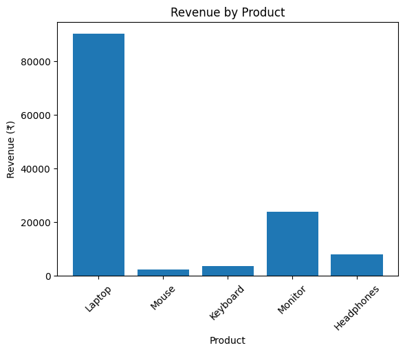
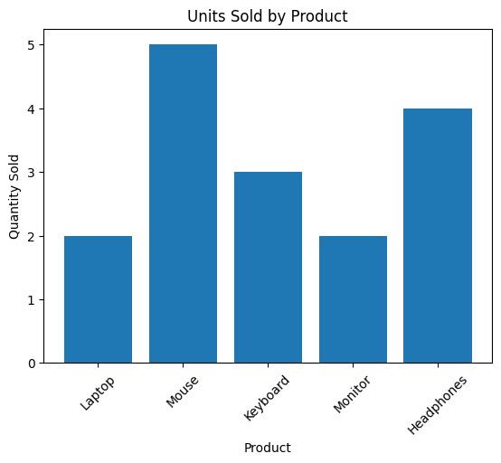
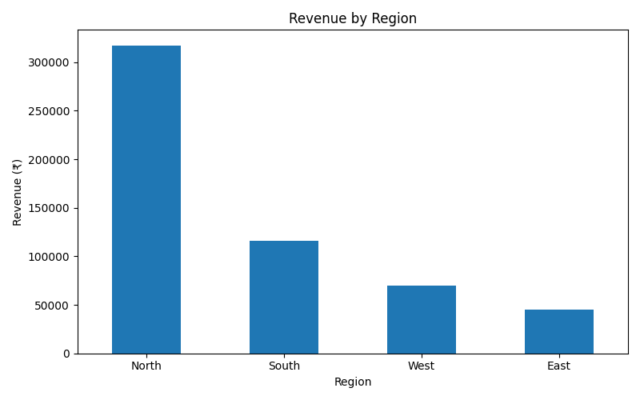
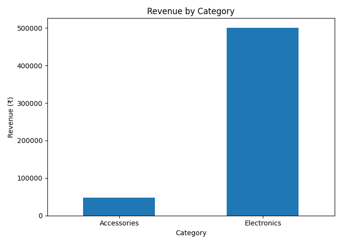

Data Analyst Portfolio

Hi! I'm an aspiring Data Analyst and a 2026 B.Tech graduate.

I'm passionate about transforming raw data into meaningful insights and solving real-world business problems through data analytics.

Skills I'm Developing

- Python
- SQL
- Microsoft Excel
- Power BI
- Data Cleaning
- Data Visualization
- Exploratory Data Analysis

Projects

1. Retail Sales Analysis

- Analyze retail sales data.
- Identify revenue trends and top-performing products.
- Build interactive dashboards.

Status: In Progress

2. E-commerce Data Analysis

Coming Soon

3. Customer Churn Analysis

Coming Soon

Tools

Python | SQL | Excel | Power BI | GitHub

Career Goal

Seeking an opportunity to begin my career as a Data Analyst and contribute to data-driven business decisions.

Thank you for visiting my portfolio!

📊 Project 1: Retail Sales Analysis

Objective

Analyze retail sales data using Python and Pandas to identify revenue patterns and product performance.

Tools Used

- Python
- Google Colab
- Pandas
- Matplotlib

Key Findings

1. Total revenue: ₹1,28,100
2. Highest revenue product: Laptop (₹90,000)
3. Highest quantity sold: Mouse (5 units)
4. Lowest revenue product: Mouse (₹2,500)
5. Average revenue per order: ₹25,620

Visualizations

- Revenue by Product
- Units Sold by Product

Learning Outcomes

- Data manipulation using Pandas
- Grouping and sorting data
- Calculating business metrics
- Creating bar charts using Matplotlib

Note: This project uses a small sample dataset created for learning purposes.

## Project Visualizations

### 1. Revenue by Product

### 2. Units Sold by Product

## Business Insights

1. Laptop generated the highest revenue of ₹90,000.
2. Mouse had the highest sales quantity with 5 units.
3. Monitor generated the second-highest revenue of ₹24,000.

## Business Recommendations

1. Investigate laptop sales trends to understand the major revenue source.
2. Explore opportunities to increase mouse sales further.
3. Monitor demand and inventory levels for high-revenue products.

## Advanced Retail Sales Analysis

### Key Business Metrics
- Total Revenue: ₹5,48,400
- Total Units Sold: 62
- Average Order Value: ₹27,420
- Total Transactions: 20

### Product Revenue Insights
- Laptop generated the highest revenue: ₹4,05,000.
- Monitor generated ₹96,000.
- Mouse generated the lowest revenue: ₹11,000.

### Regional Sales Insights
- North generated the highest revenue: ₹3,17,500.
- South generated ₹1,15,900.
- East generated the lowest revenue: ₹45,400.

### Category
 Insights
- Electronics generated ₹5,01,000.
- Accessories generated ₹47,400.
- Electronics contributed approximately 91.4% of revenue.

### Project Visualizations

#### Product Revenue

#### Regional Revenue

#### Category Revenue

